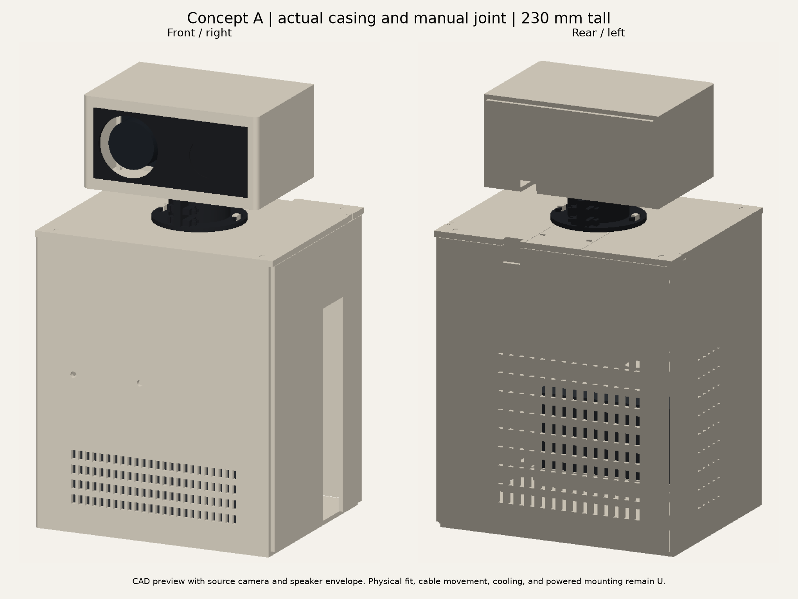

# Concept A mechanical prototype

Dylan rejected this CAD exterior on 2026-10-11 because it resembles a "1980s computer". Exterior refinement is the next task. Read [the session handoff](HANDOFF.md) first. The approved concept remains the appearance target.

The removable casing and bearing-supported camera head now have actual printable parts. The body measures 136 × 112 × 160 mm. The head measures 100 × 72 × 50 mm. Overall height is 230 mm (E). The existing STS3215 fits its reserved body space. Its installed mount and powered coupling remain pending measurements.

## View the complete design

Open [the offline CAD viewer](output/assembly/robot-viewer.html) in a browser. Select front, rear, side, or 3D views. Turn the head through ±80°. Open the service covers and show component envelopes. The viewer draws the actual printed triangles. Hardware blocks represent reference envelopes and reserved spaces. Browser appearance remains U; the viewer control checks pass.

Use [the complete assembled STEP](output/assembly/robot-assembled.step) in a CAD application. It contains 35 printed assembly parts, including the loose manual drive coupon. The [approved exterior concept](output/exterior-concept.png) provides the appearance target. The CAD preview shows the current mechanical prototype, with smaller corner radii and exposed service interfaces.

## Print files and assembly

[Bambu P1S projects](output/bambu/) contain all 44 casing, joint, cradle, gauge, and coupon parts. Each project uses PLA, the 0.4 mm nozzle, 0.2 mm layers, three walls, and automatic tree supports. Every project sliced successfully on the Mac. Inspect supports and their removal paths before printing. Start with the small gauges and spare keys. Physical fits remain U.

The separate [casing meshes](output/casing/) and [joint meshes](output/joint/) use millimeter units and checked print orientations. These generic 3MF files contain geometry. Select printer settings when importing them directly. The P1S projects include settings and sliced previews. No print was sent.

Read [casing assembly](CASING_ASSEMBLY.md) and [joint assembly](JOINT_ASSEMBLY.md) before printing. The roof uses a removable bridge. Lift the preassembled joint 5.2 mm, slide it through the rear roof channel, and lower its flange onto the roof posts. Install the bridge and its retained pins afterward. Install the camera frame before the camera.

Four detachable cradles define the proposed Jetson, speaker, audio-case, and camera positions. They include mounting posts and reference clearance. Verify safe contact lands and component retention with gauges before installing populated electronics. Keep the owned servo separate until its installed retention is defined. The manual drive gear is a loose tooth-meshing coupon.

## Joint specification

Two 15 × 24 × 5 mm bearings support a 14.8 mm journal. Their centers are Z154 and Z170. Split tower seats measure 24.2 mm. The tower has a 32 mm diameter within the 32.4 mm roof channel. Its 50 mm flange sits at Z160. The 44 mm rotating flange supports the head floor at Z180.

Stationary keeper openings measure 22 mm. Rotating spacers measure 20 mm. Their radial separation is one mm. The initial axial freedom is 0.6 mm. Optional 0.2 and 0.4 mm shims are separate gauge parts. Verify actual race contact lands before using these dimensions.

Both gears have 34 teeth, module one, a 20° pressure angle, and 34 mm center spacing. Combined nominal tangential backlash is 0.25 mm. Continuous CAD tooth clearance passes. Actual solid stops contact at ±80.02087°. The proposed normal software range remains ±70°. Stop strength and physical tooth behavior remain U.

Use external camera routing for this manual prototype. Transverse retention keys occupy the proposed shaft passage. Complete connector admission through both closed bearing bores remains pending. Check cable slack, pinching, bend radius, and connector loading throughout physical movement.

## Power, USB, and cooling

Remove the complete right panel to connect and grip the Jetson plugs. Its edge-open service slot reserves later replaceable inserts. The final insert requires actual socket coordinates and complete installed USB connector shapes.

The existing [power-exit trial](output/power-exit-trial-p1s.3mf) tests the reported 11 mm plug diameter, 11 mm straight reach, and 10 mm rotatable elbow. Its 13 mm upward-open channel sits nine mm from the provisional socket plane. The trial measures 22.85 × 60 × 33.5 mm. Its recess depth is 21.25 mm. It remains a separate hand-held gauge with no casing attachment.

Connect the plug with the supply disconnected from mains. Point the elbow upward. Raise the trial around its open channel, then check the nine mm socket-to-face distance. Lower the trial for removal. Record interference and nearby USB clearance before designing its attachment.

Rear vents preserve the fan intake reservation. Left vents preserve the outlet reservation. The speaker grille and microphone openings stay open. Actual fan orientation, microphone positions, cooling, echo, and motor noise require physical checks. Compare open and enclosed Jetson operation under the same workload before final thermal approval.

A compatible USB TTL bus-servo adapter can control the STS3215 from the Jetson without a separately programmed Uno. Identify the owned SO-ARM100 adapter revision before specifying supply wiring. The 7.4 V servo requires compatible power and current capacity. Verify its horn holes, supplied retention hardware, adapter, and mounting lands before powered design.

## Checks and regeneration

[Integrated checks](output/assembly/checks.json) cover actual casing/joint intersections, full yaw separation bounds, rear key access, and sampled joint/bridge admission. [Casing checks](output/casing/checks.json) cover panel and cradle separation, hardware reservations, component admission, and both reference lens lengths. [Joint checks](output/joint/checks.json) cover bearings, retained keys, stops, and real teeth. [Slicing checks](output/bambu/slice-checks.json) record each source hash, project hash, result, warning, and estimate.

Use Python 3.12 with [requirements.lock](requirements.lock). Run `layout.py`, `power_exit.py`, `casing.py`, `joint.py`, `assembly.py`, and `bambu.py` in that order. Run `node hardware/concept-a/check-assembly-viewer.cjs` from the repository root. The CAD environment is `build/hardware-layout/venv/bin/python`. Bambu packaging uses the installed macOS application and the saved native P1S power-trial project as its settings template.

The shared exporter welds indexed CAD face seams and checks every mesh edge twice. Generators check millimeter scale, closed volume, connected solids, and bed fit. Automatic slicing establishes printable paths. Physical coupon results, safe electronics support, material life, cable movement, powered motion, cooling, and acoustics remain U.

## Sources

- [Original hardware design](https://github.com/Dylancouzon/qdrant-edge-memory-robot/blob/cfc0dd2c5bb540f08149213c43bd33ba2d0c27f9/hardware/claude-design.html) supplies the Jetson and complete camera reference dimensions.
- [Waveshare USB audio](https://www.waveshare.com/usb-to-audio.htm) supplies the 53 × 23.5 × 14.6 mm case, excluding its USB plug.
- [Waveshare speaker](https://www.waveshare.com/8ohm-5w-speaker.htm) specifies 100 × 45 × 21 mm. Its image gives smaller dimensions; measure the owned speaker.
- [Waveshare servo documentation](https://www.waveshare.com/wiki/ST3215_Servo) supplies the proposed 45.22 × 24.72 × 35 mm housing envelope. Verify it against the owned STS3215.
- [SO-ARM100 bill of materials](https://github.com/TheRobotStudio/SO-ARM100/blob/a758567c3978dfeefe282ede0500085a48fe8f78/README.md) lists the USB-C bus-servo board and 7.4 V servos.
